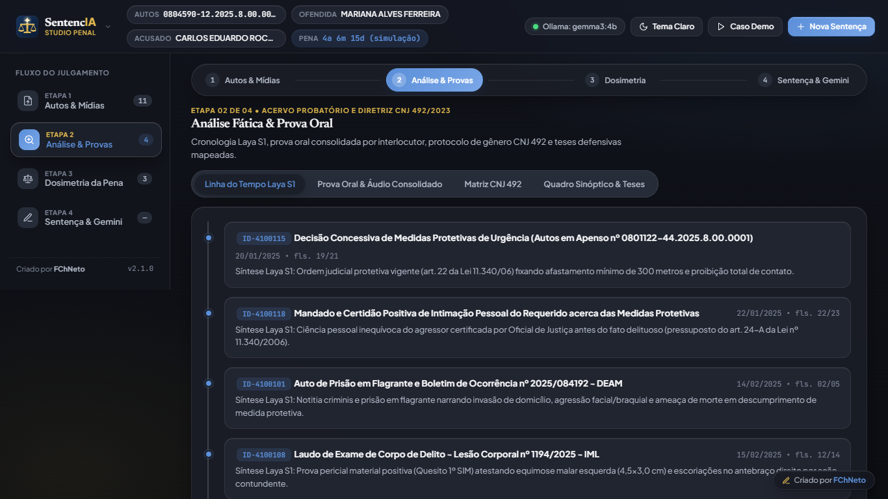

# SentencIA 2.3.1


Sistema **local** de apoio à prolação de sentenças penais no Juizado de Violência Doméstica e Familiar
contra a Mulher (Lei nº 11.340/2006 — Lei Maria da Penha).

O programa lê os autos do PJe (PDF, inclusive páginas digitalizadas via OCR) e as gravações das audiências,
organiza as peças, transcreve os depoimentos, calcula a dosimetria trifásica e a prescrição, monta uma
**minuta** de sentença e a submete a um auditor anti-alucinação antes da exportação para Word, PDF ou
cópia/HTML para o PJe.

> **⚠️ Aviso Institucional — A decisão é sempre do magistrado:** Toda sentença produzida pelo SentencIA é
> uma **minuta de apoio para revisão, edição e decisão exclusiva do(a) Juiz(a) de Direito**. O sistema
> nunca condena por padrão: em processo real, a minuta só é gerada depois que o juízo informa o veredicto
> de cada crime (condenar, absolver, desclassificar ou extinguir a punibilidade). Dados que não puderam ser
> extraídos dos autos nunca são inventados: o sistema pede a complementação ou insere o marcador
> `[COMPLETAR PELO JUÍZO: ...]`, e a auditoria só aprova a minuta quando não restam marcadores.



## Instalação rápida (1 comando, sem administrador)

- **Windows (PowerShell):**
  ```powershell
  irm https://github.com/Chneto/SentencIA/releases/latest/download/instalar.ps1 | iex
  ```
- **macOS (Terminal — Apple Silicon e Intel, sem conta Apple):**
  ```bash
  curl -fsSL https://github.com/Chneto/SentencIA/releases/latest/download/instalar-mac.sh | bash
  ```

Também disponível como instalador gráfico **`SentencIA-Setup-2.3.1.exe`** e pacote portátil **`.zip`** em [Releases](https://github.com/Chneto/SentencIA/releases).
Consulte o **[Guia Completo de Instalação](docs/INSTALACAO.md)** ([versão em PDF](docs/INSTALACAO.pdf)) e o **[Guia do Usuário](docs/GUIA_DO_USUARIO.md)**.

---

## 1. Requisitos

| | Windows | macOS |
|---|---|---|
| Sistema | Windows 10 ou 11, 64 bits (x64; em PCs ARM64 o Python x64 emulado é usado automaticamente) | macOS 13 (Ventura) ou mais recente — Apple Silicon (M1/M2/M3/M4) ou Intel |
| Memória | 8 GB (16 GB recomendados para transcrição e IA local) | 8 GB (16 GB recomendados) |
| Disco | ~3 GB para o programa e as dependências; +2 a 5 GB se instalar a IA local (Ollama) | idem |
| Internet | Só na **primeira** instalação (e para baixar o modelo de IA, se desejar) | idem |
| Navegador | Chrome, Edge ou Brave (abre em modo aplicativo); qualquer navegador moderno serve | Chrome, Edge, Brave ou Safari |
| Administrador | **Não é necessário** | **Não é necessário** (sem `sudo`) |

Nada precisa estar instalado antes: o iniciador instala o que faltar (o gerenciador `uv`, o Python 3.12
e as bibliotecas), tudo dentro do seu perfil de usuário.

Placa de vídeo é opcional. Com NVIDIA (CUDA) a transcrição é mais rápida; sem ela, ou no Mac, a
transcrição roda no processador.

---

## 2. Instalação e uso em 1 clique

### Windows

1. Extraia o arquivo `SentencIA-v2.3.1.zip` (botão direito → **Extrair Tudo...**).
   Prefira uma pasta **fora do OneDrive**, por exemplo `C:\SentencIA` ou `Documentos`: os autos
   são sigilosos e não devem ser sincronizados com a nuvem. O iniciador avisa se a pasta estiver no
   OneDrive.
2. Abra a pasta extraída e dê dois cliques em **`Iniciar SentencIA.bat`**.
   - Se o Windows mostrar "O Windows protegeu o computador" (SmartScreen), clique em
     **Mais informações → Executar assim mesmo**.
3. Na primeira vez uma janela mostra cada etapa: instalação do `uv`, do Python 3.12 e das
   dependências (alguns minutos). Ela faz até três perguntas, todas opcionais:
   - instalar os componentes de **nuvem** (Gemini) — padrão **não**;
   - instalar a **IA local (Ollama)** e baixar o modelo — padrão sim; pode recusar;
   - criar um **atalho na Área de Trabalho** — padrão sim.
4. Ao final o sistema abre no navegador (em janela própria, quando há Chrome/Edge/Brave).

Nas próximas vezes, use o atalho da Área de Trabalho ou o mesmo `.bat`: as etapas já feitas são
puladas e o sistema abre em segundos. O atalho usa `Iniciar_SentencIA.vbs`, que inicia sem
janela quando a instalação já existe.

### macOS

1. Dê dois cliques no `.zip` para extrair e **mova a pasta extraída para `Documentos`** (ou outra
   pasta sua). Não rode o programa de dentro de `Downloads` sem mover: o macOS pode executá-lo a partir
   de uma cópia temporária protegida ("App Translocation"), e o iniciador avisa se isso acontecer.
2. Na pasta, clique com o **botão direito** (ou Control + clique) em **`Iniciar SentencIA.command`**
   e escolha **Abrir**. Confirme **Abrir** no aviso. Isso é necessário só na primeira vez, porque o
   programa não é assinado pela Apple (Gatekeeper).
   - No macOS 15 (Sequoia) ou mais recente, se não aparecer a opção "Abrir": tente abrir uma vez,
     depois vá em **Ajustes do Sistema → Privacidade e Segurança** e clique em **Abrir Mesmo Assim**.
   - Alternativa pelo Terminal (remove a quarentena da pasta inteira de uma só vez):

     ```bash
     xattr -dr com.apple.quarantine ~/Documents/SentencIA-v2.3.1
     ```
3. O Terminal abre e mostra as etapas (iguais às do Windows). No Mac o Ollama é instalado pelo
   Homebrew, se você o tiver; caso contrário, o iniciador abre a página oficial de download.
4. Ao final o sistema abre no navegador. A janela do Terminal pode ser fechada; o servidor continua
   ativo em segundo plano.

Também há o aplicativo **`SentencIA.app`** na pasta: ele abre o mesmo iniciador no Terminal.
Mantenha-o dentro da pasta do programa (ou use o atalho que o instalador cria na Mesa). Ao rodar o
`.command`, o instalador remove a quarentena do macOS (`com.apple.quarantine`) de toda a pasta do
programa, inclusive do `.app`, para que o atalho da Mesa não caia em "App Translocation". Se você abrir
o `.app` antes de rodar o `.command` uma vez, valem os mesmos passos do Gatekeeper (botão direito → Abrir).

O iniciador detecta Apple Silicon ou Intel e instala as bibliotecas nativas certas. Se o Terminal
estiver rodando sob Rosetta em um Mac Apple Silicon, ele se reinicia em modo nativo (arm64).

### Opções do iniciador (avançado)

| Windows (`Iniciar SentencIA.bat ...`) | macOS (`./Iniciar\ SentencIA.command ...`) | Efeito |
|---|---|---|
| `-Reinstalar` | `--reinstalar` | refaz a instalação das dependências e repete as perguntas recusadas |
| `-Nuvem` | `--nuvem` | instala também os componentes de nuvem (Gemini, SpeechRecognition) |
| `-SemPerguntas` | `--sem-perguntas` | não pergunta nada (não instala nada opcional) |
| `-SemIniciar` | `--sem-iniciar` | só instala/confere; não abre o sistema |
| `-SemNavegador` | `--sem-navegador` | inicia o servidor sem abrir o navegador |

Para **encerrar o servidor**: Windows `.venv\Scripts\python.exe launcher.py --parar`;
macOS `.venv/bin/python launcher.py --parar`. Para ver se está ativo: `launcher.py --status`.

### O que o iniciador instala

- **uv** (gerenciador de Python da Astral) em `%USERPROFILE%\.local\bin` (Windows) ou `~/.local/bin`
  (macOS), pelo instalador oficial `astral.sh`.
- **Python 3.12** gerenciado pelo `uv` (não altera nenhum Python que você já tenha).
- O ambiente do programa em `.venv` (dentro da pasta do programa), com as versões travadas em `uv.lock`:
  - núcleo: FastAPI, Uvicorn, PyMuPDF, python-docx, ReportLab, Pillow, httpx, `keyring` (cofre do sistema
    para a chave do Gemini) e OCR nativo (`winocr` no Windows / `ocrmac` no macOS);
  - `transcricao`: `faster-whisper` — transcrição **local** das audiências;
  - `nuvem` (opcional, só se você aceitar): `google-genai`, `SpeechRecognition`, `imageio-ffmpeg`.
- Se um componente opcional não puder ser instalado na sua máquina, o iniciador segue sem ele e avisa
  (por exemplo: sem `transcricao`, as mídias ficam com status **FALHOU** até que seja instalada).
- A instalação fica registrada em `data/.instalado` e só é refeita quando `pyproject.toml` ou
  `uv.lock` mudam (ou com `-Reinstalar`).

**IA local (Ollama), opcional:** refina a redação das seções sem enviar nada para fora do computador.
Sem ela o sistema funciona com o motor determinístico. O modelo padrão é `gemma4:e2b` (alterável em
Configurações).

---

## 3. Funcionalidades e como usar

O fluxo principal é organizado em **4 estações** na barra lateral (e um **menu no logo** no canto superior
esquerdo que concentra temas, jurisprudência, pré-análise em lote, configurações, telemetria e "Sobre"):

1. **Autos & Mídias:** envie o PDF integral do processo (PJe) e as mídias das audiências
   (`.mp4`, `.m4a`, `.mp3`, `.wav`, `.ogg`, `.mkv`). Páginas digitalizadas passam por **OCR nativo com
   barra de progresso por página** e botão **Refazer OCR** caso necessário. O caso de demonstração já vem
   carregado para conhecer o sistema; arquivos já colocados em `data/cases` podem ser carregados por
   "Carregar do disco".
2. **Análise & Provas:** confira o índice das peças, as transcrições literais citáveis e o que o sistema
   não conseguiu extrair (data do fato, recebimento da denúncia, crimes imputados, nomes...). Complete no
   formulário; nada é inventado.
3. **Dosimetria da Pena:** informe o **veredicto de cada crime** (condenar, absolver com o inciso do
   art. 386 do CPP, desclassificar ou extinguir a punibilidade pelo art. 107 do CP) e ajuste as circunstâncias
   judiciais e demais parâmetros. O simulador mostra penas, regime por espécie, prescrição por crime e
   alertas.
4. **Sentença:** gere a minuta (motor determinístico, Ollama local ou Gemini opcional com
   pseudonimização), revise na folha com barra de formatação, painel de revisão, trechos do gabinete e
   histórico de versões, e confira o **laudo da auditoria** (forma, penas do dispositivo × dosimetria e
   marcadores pendentes).
5. **Exportar e copiar para o PJe:** exporte para Word (`.docx`), PDF ou HTML, ou use **Copiar para o PJe**
   — o HTML copiado passa por higienização por lista branca (mantendo parágrafos, negritos, recuos e
   referências `Id.`/`ID-` com fallback limpo em texto simples). **A assinatura digital é feita diretamente
   no editor do PJe**, fora do SentencIA. A exportação definitiva exige auditoria aprovada; antes disso é
   possível exportar um **rascunho** com marca d'água **MINUTA NÃO AUDITADA**.
6. **Nova sentença:** "Zerar produção" mantém os autos; "Limpar tudo" arquiva o caso em
   `data/cases/_arquivados/<data>.zip` (com deduplicação) — a exclusão definitiva exige confirmação expressa.

### Novidades das versões 2.2 e 2.3

- **Sentença mais segura e auditável:**
  - só afirma o que o juízo registrou como provado por imputação;
  - traz uma única decisão de confissão por imputação (conflito entre Análise e Dosimetria bloqueia o cálculo; Tema 1194/STJ);
  - a detração só usa custódias com vínculo documental inequívoco;
  - a prescrição retroativa exige a estabilidade da acusação no mesmo título da pena usada.
- **Decisões acessórias completas:**
  - substituição da pena (inclusive a exceção do art. 44, § 3º, para reincidente);
  - sursis comum e etário/humanitário (art. 77, § 2º);
  - medidas protetivas;
  - efeitos do art. 92, § 2º, do CP (Lei 14.994/2024).
  Tudo isso entra no rascunho do caso e a reauditoria aponta comandos contraditórios em qualquer seção da minuta.
- **Leitura dos autos mais fiel:** o OCR não substitui texto nativo legível e as peças sem espécie reconhecida
  continuam no índice como "não identificada".
- **Tema Matilha:** o pug e o rottweiler acompanham o trabalho (estados vazios, auditoria, avisos), com
  variantes à escolha e easter eggs. Sons desligados por padrão; a folha da sentença e as exportações
  continuam formais em qualquer tema.

### Recursos adicionais

- **Menu do logo, 5 temas e paleta de comandos (`Ctrl+K`):** escolha entre *Original*, *Gabinete Clássico*,
  *Estúdio Moderno*, *Cockpit / Alta Densidade* e *Matilha*, todos com modo claro e escuro e fontes locais.
- **Pré-análise de processos em lote:** envie vários PDFs de uma vez, acompanhe a triagem em segundo plano
  e abra qualquer processo diretamente na sessão de trabalho.
- **Jurisprudência do gabinete e acervo fechado:** consulte o acervo verificado (incluindo o Tema 1197/STJ
  e súmulas da área) e cadastre, edite, valide, exporte ou importe os precedentes do próprio juízo.
- **Gemini com seletor dinâmico e "Testar chave":** nas Configurações, valide sua chave do Gemini em um
  clique e use a seleção dinâmica de modelos com fallback automático.
- **Ollama com seletor de modelos instalados:** escolha entre os modelos efetivamente instalados no Ollama
  local, com aviso claro quando o modelo configurado estiver ausente.
- **Retenção do arquivo morto:** configure a política de limpeza dos arquivos em `data/cases/_arquivados/`
  nas Configurações, com prévia (simulação) antes de remover qualquer arquivo.
- **Otimização de VRAM e "Modo GPU moderado":** coordenação automática entre Whisper e Ollama e opção
  *Modo GPU moderado* nas Configurações para reduzir picos de uso da placa de vídeo (fila única de GPU,
  teto de 70% de VRAM, contexto limitado e Whisper econômico).

Para instruções detalhadas de uso no dia a dia do gabinete, consulte o **[Guia do Usuário](docs/GUIA_DO_USUARIO.md)**
e o **[Histórico de mudanças](CHANGELOG.md)**.

---

## 4. Privacidade e segurança (segredo de justiça / LGPD)

- Tudo roda **no seu computador**. O servidor escuta apenas em `127.0.0.1` (não fica acessível na
  rede), exige um token de sessão gerado a cada inicialização e recusa outros hosts e origens.
- **Nenhum dado do processo sai da máquina** sem duas autorizações: a opção "permitir envio externo"
  ligada nas Configurações **e** o consentimento marcado na própria operação (transcrição ou Gemini).
  A transcrição usa primeiro o Whisper local.
- A chave do Gemini nunca fica no navegador nem em `user_settings.json`: vai para o cofre do sistema
  (Credential Manager / Keychain) ou, na falta dele, para `data/secrets/secrets.json` (permissão
  restrita no macOS).
- Os autos, caches, transcrições, exportações e logs ficam em `data/`. O pacote de distribuição
  **não contém** nenhum desses arquivos, nem as suas preferências, segredos ou modelos do gabinete.
- Evite pastas sincronizadas (OneDrive, iCloud Drive, Google Drive) para o programa e os autos. Para
  manter os dados em outro lugar, defina `SENTENCIA_DATA_DIR` (veja abaixo).

---

## 5. Solução de problemas

| Sintoma | O que fazer |
|---|---|
| A janela do instalador mostra **ERRO** | Leia a mensagem; o registro completo está em `data/logs/bootstrap.log`. Confira a internet e rode o iniciador de novo (ele continua de onde parou). |
| "O servidor não respondeu a tempo" | Veja `data/logs/servidor.log` e `data/logs/launcher.log`. Rode o iniciador com `-Reinstalar` / `--reinstalar`. |
| A página diz que a sessão expirou (erro 401) | O servidor foi reiniciado: recarregue a página (F5 / Cmd+R). |
| Porta 8000 ocupada | Nada a fazer: o iniciador escolhe a próxima porta livre. Para fixar outra: variável `SENTENCIA_PORT`. |
| Mídias com status **FALHOU** | A transcrição local não está instalada ou não encontrou fala. Rode o iniciador com `-Reinstalar`; veja o erro exibido na lista de mídias. |
| Páginas digitalizadas sem texto (`ocr_pendente`) | O OCR do sistema não está disponível. No Windows, instale o idioma Português com "Reconhecimento óptico de caracteres" em Configurações → Hora e idioma. |
| A IA local não é usada | Verifique se o Ollama está aberto e se o modelo configurado foi baixado (`ollama list`). O status aparece no painel do sistema. |
| Windows: "a execução de scripts foi desabilitada" | Use sempre o `.bat` (ele chama o PowerShell com `-ExecutionPolicy Bypass` só para o instalador). |
| macOS: "não pode ser aberto porque é de um desenvolvedor não identificado" | Botão direito → Abrir, ou Ajustes do Sistema → Privacidade e Segurança → Abrir Mesmo Assim, ou `xattr -dr com.apple.quarantine <pasta>`. |
| macOS: "Permission denied" ao abrir o `.command` | No Terminal: `chmod +x "Iniciar SentencIA.command" instalador/bootstrap.sh "SentencIA.app/Contents/MacOS/sentencia"`. |

Registros (`data/logs/`): `bootstrap.log` (instalador), `launcher.log` (iniciador), `servidor.log`
(saída do servidor), `app.log` (aplicação, com rotação) e `ollama.log`.

### Variáveis de ambiente

| Variável | Efeito |
|---|---|
| `SENTENCIA_PORT` | Porta preferida do servidor (padrão 8000). |
| `SENTENCIA_DATA_DIR` | Pasta de dados fora do programa (ex.: `~/Library/Application Support/SentencIA` no macOS). |
| `SENTENCIA_OCR=desligado` | Desativa o OCR das páginas digitalizadas. |
| `SENTENCIA_SECRETS_BACKEND=arquivo` | Força o cofre em arquivo em vez do Credential Manager/Keychain. |
| `SENTENCIA_ALLOWED_HOSTS` | Hosts adicionais aceitos pelo servidor (separados por vírgula). |

*(Nomes legados com prefixo `JVDFM_*` continuam aceitos temporariamente com aviso no log.)*

### Desinstalar

Apague a pasta do programa (guarde antes o que quiser de `data/`). Opcionalmente: `uv python uninstall
3.12`, `uv cache clean` e a remoção do `uv` (`~/.local/bin/uv`). A chave do Gemini fica no cofre do
sistema com o nome de serviço `SentencIA` (credenciais antigas em `SentencaJVDFM` são migradas automaticamente).

### Vindo da versão 1.0.0

A 2.0.0 fica em pasta própria e não altera a anterior. Para aproveitar dados da 1.0.0, copie
`data/knowledge_base/custom_precedentes.json` e, se quiser, `data/user_settings.json` (a chave do
Gemini que estiver nele é movida para o cofre na primeira abertura).

---

## 6. Desenvolvimento

```bash
uv sync --all-extras          # ambiente completo (no Windows o extra ocr-macos é ignorado)
uv run playwright install chromium  # uma única vez, para os testes E2E de layout/UI
uv run pytest -q              # suíte de testes
uv run python -m app.main     # servidor em 127.0.0.1:${SENTENCIA_PORT:-8000}
uv run python launcher.py     # iniciador (porta livre + navegador)
```

- Sem o Chromium do Playwright instalado (`uv run playwright install chromium`), os testes E2E de
  layout/interface aparecem como *skipped* na saída do `pytest`, indicando o motivo e o comando de
  instalação; os demais testes unitários e de API continuam executando normalmente.
- Testes que exigem os **autos reais** (sigilosos) usam o marcador `dados_reais` e só rodam com
  `SENTENCIA_REAL_CASES_DIR` apontando para a pasta dos PDFs/MP4: `uv run pytest -m dados_reais`.
- Pacote de distribuição: `uv run python scripts/build_release.py --dry-run` lista o que entraria;
  sem `--dry-run` gera `dist/SentencIA-v<versão>.zip` e `dist/SHA256SUMS.txt` (permissões Unix
  preservadas para o macOS; testes, autos, preferências, segredos, modelos e capturas de tela ficam de
  fora).
- Detalhes técnicos: `docs/context.md` (ambiente, estrutura e rotas) e `docs/INSTALACAO.md` (instalação em Windows e macOS).
  Histórico de mudanças: `CHANGELOG.md`.

---

## 7. Licença

Distribuído sob a **[Licença MIT](LICENSE)** — Copyright (c) 2026 **FChNeto**.

> *As minutas geradas pelo SentencIA constituem instrumento de apoio técnico-jurídico e exigem conferência integral, revisão e assinatura digital pelo(a) magistrado(a) competente no sistema processual oficial (PJe).*
